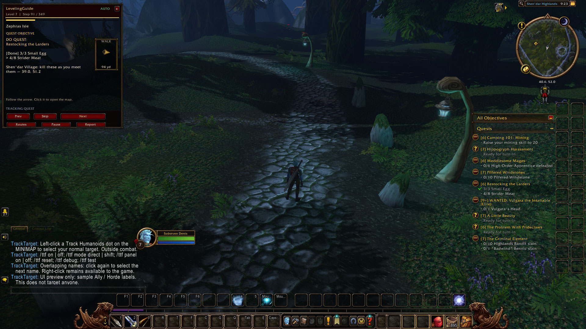

# TrackTarget Forever

**Turn a Track Humanoids minimap marker into your normal WoW target with a click.**

TrackTarget Forever is a lightweight minimap companion for Hunters and Druids in **World of Warcraft: Forever**. With Track Humanoids active, hover a marker and left-click to attempt to select that character in the standard target frame. Inspect the target using the game's usual class and level information when available.

## Features

- **Direct minimap clicks:** select from existing Track Humanoids markers, outside combat.
- **Compact faction feedback:** Ally, Horde, NPC or an unknown result, based on the confirmed target.
- **Overlapping markers:** repeat the click to cycle through candidate names, one target per click.
- **Optional Shift-click mode** and a show/hide switch for the faction label.
- **Simple setup:** no extra library or external application required.
- **English and Bulgarian guides**, built-in help and troubleshooting commands.

## Getting started

1. Extract the release ZIP into your Forever client's `Interface/AddOns` folder. The path should end with `TrackTargetForever/TrackTargetForever.toc`.
2. Enable **TrackTarget Forever** in the AddOns list and restart the client if needed.
3. Activate **Track Humanoids**. Druids must use a form that provides the ability.
4. Outside combat, hover a tracking marker until its name appears, then left-click it.

The normal minimap right-click action remains available. The addon does not attack, cast spells, enable tracking or change forms for you.

## Commands

| Command | Action |
| --- | --- |
| `/ttf` | Show help. |
| `/ttf on` / `/ttf off` | Enable or disable the addon. |
| `/ttf mode direct` | Use a direct left-click (default). |
| `/ttf mode shift` | Require Shift + left-click. |
| `/ttf panel on` / `/ttf panel off` | Show or hide faction feedback. |
| `/ttf reset` | Restore addon defaults. |
| `/ttf debug` | Print diagnostics for troubleshooting. |
| `/ttf test` | Preview a sample label without selecting anyone. |

## Compatibility and current limitations

**Version 0.1.0 targets WoW Forever, Interface 16001 (1.60.1).** Requires active Hunter or Druid Track Humanoids. Dynamic targeting is available **outside combat only**; hover the marker again after combat ends.

A visible marker does not guarantee a target is reachable. Name-based targeting can select a nearby NPC with the same name. Faction and current attackability are separate properties. Custom minimaps and UI replacements may affect compatibility.

This first release remains experimental. Addon loading, help and the sample-label preview have been observed in the live client; actual marker-to-target selection and secure mouse routing have not been verified in this session. The sample preview is a UI demonstration, not proof of successful targeting. Please report reproducible issues with your client build, class/form and other UI addons.

## Screenshots

Real in-game capture showing help and the sample-preview notice. Other visible UI panels belong to the game or other addons.

## Community and support

Made by **Denis Aleksandrov · Razer Dev Studio**. Free to download and use. Donations are optional and help support development, testing and updates.

- [Join the Discord community](https://discord.gg/Pr5eMAUqt) — feedback, questions and bug reports.
- [Donate / leave a tip with Revolut](https://revolut.me/denisar2z).
- [Support development on Patreon](https://www.patreon.com/c/DenisAleksandrov/membership).
- [Source code and issues on GitHub](https://github.com/sobata1995-source/TrackTargetForever).
- [Browse my CurseForge projects](https://www.curseforge.com/members/sobstven/projects).

Original addon code under the **MIT License**. This is an independent community addon and is not an official Blizzard product.
